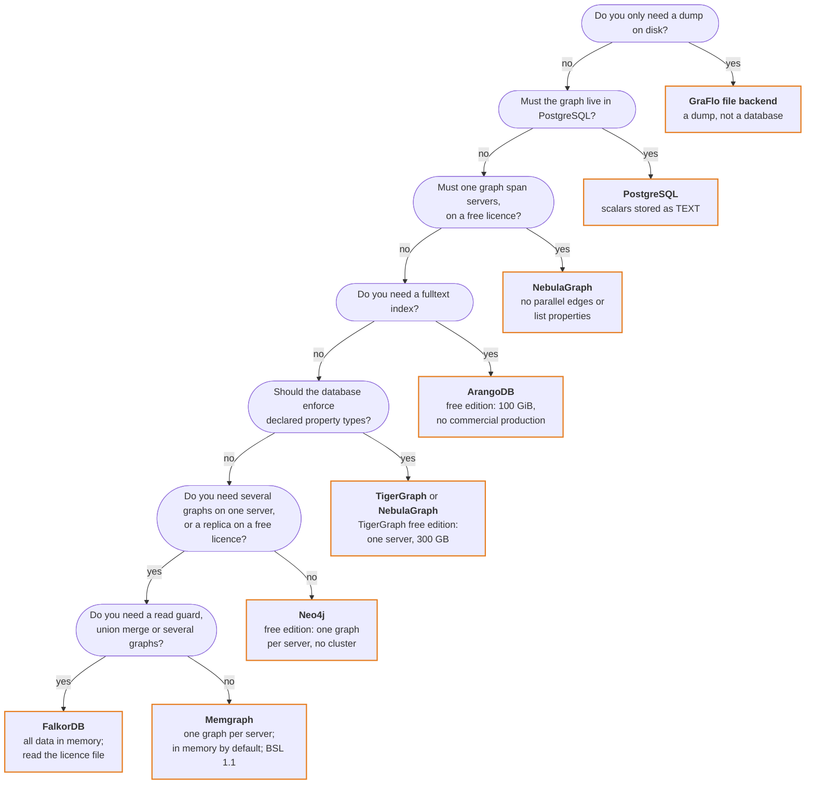

# Which graph database should I use with GraFlo?

One manifest loads into eight targets, but they do not all offer the same
features. This page is for anyone choosing where to put a graph. Start with the
tree: it leads to a target from what you need. The tables behind it show what
GraFlo does on each target, and what each server's free edition allows, so you
can rule out a database before you install it.

## Which target fits what you need?

If you already run one of these databases, keep it and check the tables for what
it lacks. Otherwise, answer from the top. The first `yes` decides, so check the
target you reach against the tables for anything else you need.

- **File backend:** a dump of a graph, not a database to serve it from. It has no
  index and no query language, every read scans the records it reads, and it
  cannot delete. Use it to save or move a graph and in tests, and load the graph
  into a database to use it.
- **One graph per server:** Neo4j Community and Memgraph hold one database for
  your data, so one server holds one schema. Neo4j Enterprise holds one per
  namespace. See
  [Neo4j and Memgraph](../guides/graph_namespace_and_schema.md#neo4j-and-memgraph).
- **Memory:** FalkorDB [keeps its data in memory](https://docs.falkordb.com/design/),
  and Memgraph [does by default](https://memgraph.com/docs/fundamentals/storage-memory-usage);
  its on-disk mode is experimental. Size the server for the whole graph.
- **Size:** Neo4j Community's [store format](https://neo4j.com/docs/operations-manual/current/database-internals/store-formats/)
  holds up to 2^35, about 34 billion, nodes and as many relationships.
- **Read guard** and **union merge:** see [aspects](schema/aspects.md).
- **Licences:** the [free edition table](#what-the-free-editions-allow) says what
  each licence allows. Read it before you offer a graph database to others as a
  service.

The tree weighs features and licence terms, not speed. In the tables below,
`refused` means GraFlo raises an error when the schema is applied, naming what it
cannot build. `no` means the target does not have the feature.

## Indexes

| Backend | Composite on vertices | Composite on edges | Unique on vertices | Unique on edges | Edge index | Fulltext |
|---|---|---|---|---|---|---|
| ArangoDB | yes | yes | yes | yes | yes | yes |
| Neo4j | yes | yes | yes | yes | yes | refused |
| Memgraph | yes | refused | yes | refused | yes | refused |
| FalkorDB | per field | per field | yes | yes | yes | refused |
| TigerGraph | refused | refused | refused | refused | refused | refused |
| NebulaGraph | yes | yes | refused | refused | yes | refused |
| PostgreSQL | yes | yes | yes | yes | yes | refused |
| GraFlo file backend | no | no | no | no | no | no |

- `refused` applies to an index you declare. One GraFlo derives itself, for an
  identity or a secondary identity, is skipped with a warning instead.
- `per field`: FalkorDB keeps one index per label, so each field is indexed
  separately. A `unique` index is still one constraint over the fields together.
- On NebulaGraph, GraFlo gives every field of an edge index a string length, and
  the server may reject that on a non-string field. A rejected index only logs a
  warning.
- GraFlo builds no vector index on any target.

[Backend indexes](schema/backend_indexes.md) has the statements behind each cell.

## Types and constraints

| Backend | Declared types reach the schema | List properties | Vertex identity enforced by | Parallel edges | Undirected edge type | Reverse read |
|---|---|---|---|---|---|---|
| ArangoDB | no | yes | unique index or `_key` | yes | no | same as forward |
| Neo4j | no | yes | uniqueness constraint | yes | no | little cost |
| Memgraph | no | yes | index and uniqueness constraint | yes | no | little cost |
| FalkorDB | no | yes | uniqueness constraint | yes | no | little cost |
| TigerGraph | yes | yes | primary key | yes | yes | needs a declared inverse |
| NebulaGraph | yes | refused | vertex ID built from the identity | no | no | reverse clause |
| PostgreSQL | lists only | yes | primary key | yes | no | same as forward |
| GraFlo file backend | no | yes | not enforced; reads fold by identity | yes | no | index built on read |

- **Declared types reach the schema:** where it says `no`, a value is stored as
  it arrives. PostgreSQL stores every scalar as `TEXT`. See
  [supported field types](architecture/core_components.md#supported-field-types).
- **Parallel edges:** several edges between the same two vertices, told apart by
  the properties in the edge's `identities`. NebulaGraph writes every edge at
  rank 0 and keeps the first.
- **Reverse read:** on TigerGraph, an undirected edge type also reads both ways.
  See [directed, undirected, and bidirectional
  edges](architecture/core_components.md#directed-undirected-and-bidirectional-edges).
- **Multiple labels:** each vertex type writes one label on every target.
- **Existence constraints:** GraFlo creates none on a graph database. PostgreSQL
  edge tables declare their endpoint columns `NOT NULL`.

## Reading and changing a graph

| Backend | Read back whole | Schema introspection | Migration DDL | Delete | Delete a scope | Read guard | Union merge | Bulk load | Sync |
|---|---|---|---|---|---|---|---|---|---|
| ArangoDB | yes | sampled | yes | yes | no | no | no | yes | no |
| Neo4j | yes | sampled | yes | yes | yes | yes | yes | yes | yes |
| Memgraph | no | sampled | no | yes | no | no | no | yes | no |
| FalkorDB | yes | sampled | no | yes | yes | yes | yes | yes | yes |
| TigerGraph | no | catalog | no | yes | no | no | no | yes | no |
| NebulaGraph | no | sampled | no | yes | no | no | no | yes | no |
| PostgreSQL | yes | catalog | no | yes | no | no | no | yes | no |
| GraFlo file backend | yes | catalog | no | no | no | yes | yes | yes | no |

- **Read back whole:** the target can be the source of `export_graph` and
  `migrate_graph`. See
  [graph export and migration](operations/graph_export_migration.md).
- **Schema introspection:** `sampled` recovers a schema from sampled records, so
  a property that appears in none of them is missed.
- **Migration DDL:** see [schema migration](operations/migration_and_practices.md),
  including how it treats a database that already holds a graph.
- **Delete** and **Delete a scope:** see
  [removing vertices and edges](operations/deleting_instances.md).
- **Read guard** and **Union merge:** see [aspects](schema/aspects.md).
- **Bulk load:** loads an empty target without lookups. See
  [bulk load](../guides/bulk_load.md).
- **Sync:** replaces what changed owner records wrote in a loaded target. See
  [record sync](../guides/record_sync.md).

## What the free editions allow

These are the vendors' published terms for the version named, not GraFlo's. They
change, so read the linked page and the licence before you rely on a row.

| Server | Free edition and licence | Limits in the terms | Clustering or replication | Multiple databases | Checked against |
|---|---|---|---|---|---|
| ArangoDB | Community Edition, [ArangoDB Community License](https://docs.arango.ai/arangodb/stable/features/) | 100 GiB dataset; no commercial use in production | all Enterprise features included since 3.12.5 | [yes](https://docs.arango.ai/arangodb/stable/concepts/data-structure/databases/) | 3.12.13 |
| Neo4j | [Community Edition](https://neo4j.com/docs/operations-manual/current/introduction/), GPLv3 | [key, existence and property type constraints](https://neo4j.com/docs/cypher-manual/current/schema/constraints/create-constraints/) are Enterprise | no | no, one beside `system` | 2026.10 |
| Memgraph | Community Edition, [Business Source License 1.1](https://raw.githubusercontent.com/memgraph/memgraph/master/licenses/BSL.txt) | internal business purposes; no embedding or distribution to third parties, database-as-a-service or competing product | [replication with manual failover](https://memgraph.com/docs/clustering/replication); automatic failover is Enterprise | [Enterprise only](https://memgraph.com/docs/database-management/multi-tenancy) | 3.14 |
| FalkorDB | no separate edition; the [licence file](https://raw.githubusercontent.com/FalkorDB/FalkorDB/v6.0.3/LICENSE) holds SSPLv1 and Elastic License 2.0, and the [docs](https://docs.falkordb.com/references/license) name SSPLv1 | offering it as a service means releasing that service's source under SSPLv1 | [replication](https://docs.falkordb.com/operations/replication.html); [clustering](https://docs.falkordb.com/operations/cluster.html) places whole graphs on shards | [yes](https://docs.falkordb.com/commands/graph.list.html) | 6.0.3 |
| TigerGraph | Community Edition, [free proprietary licence](https://www.tigergraph.com/license-agreement/) | 300 GB of graph and vector data; the licence covers internal use and bars running or publishing benchmarks | [single server only](https://www.tigergraph.com/docs/tigergraph-server/4.2/intro/comparison-of-editions) | not stated for this edition | 4.2.5 |
| NebulaGraph | Community Edition, [Apache-2.0](https://docs.nebula-graph.io/3.8.0/1.introduction/1.what-is-nebula-graph/) | none in the licence | [yes](https://docs.nebula-graph.io/3.8.0/4.deployment-and-installation/2.compile-and-install-nebula-graph/deploy-nebula-graph-cluster/) | [yes, graph spaces](https://docs.nebula-graph.io/3.8.0/3.ngql-guide/9.space-statements/1.create-space/) | 3.8.0 |
| PostgreSQL | [PostgreSQL License](https://www.postgresql.org/about/licence/) | none in the licence | [streaming replication](https://www.postgresql.org/docs/current/warm-standby.html) | [yes](https://www.postgresql.org/docs/current/managing-databases.html) | 18.6 |

The `Multiple databases` column is what the server allows. On Memgraph, GraFlo
does not use more than one, whatever the edition allows.

**Missing identity fields:** on [Neo4j](https://neo4j.com/docs/cypher-manual/current/schema/constraints/create-constraints/)
and [FalkorDB](https://docs.falkordb.com/commands/graph.constraint-create.html),
a uniqueness constraint does not apply to a vertex that lacks one of its fields.
GraFlo's identity constraint there does not catch a missing field.

## What to read next

- [Database connections](../guides/database_connections.md): point GraFlo at the
  database you chose.
- [Backend indexes](schema/backend_indexes.md): which indexes to declare.
- [Graph DB migration](../guides/graph_db_migration.md): move a graph if you
  change your mind.
