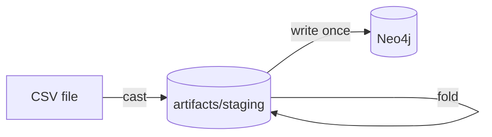

# How do I load a large graph into an empty database?

You have a large input and an empty database, and loading it the ordinary way,
one batch at a time, is too slow. Each batch asks the database, for every
vertex and edge, whether it already exists.

A bulk load answers that question once, before writing anything. GraFlo casts
the whole input to a staging directory and folds every vertex and edge to one
row by its identity. It then writes each row once, with no lookups. The graph
it ends with is the one an ordinary load of the same input would produce.



## What you need

- GraFlo with the `bulk` extra (`pip install 'graflo[bulk]'`).
- The repository's Neo4j container, see
  [`docker/README.md`](../../docker/README.md).

## The data

[`data/works.csv`](data/works.csv) lists papers with their author and venue.
Paper `W2` appears twice: the second row corrects a typo in its title.
[`manifest.yaml`](manifest.yaml) makes a `work` vertex per paper, an `author`
and a `venue`, and an edge from each work to its author and to its venue.

## Steps

### 1. Load in bulk

[`ingest.py`](ingest.py) asks for bulk mode and names the staging directory:

```python
engine.define_and_ingest(
    manifest=manifest,
    target_db_config=conn_conf,
    ingestion_params=IngestionParams(mode="bulk", staging_dir=staging),
    recreate_schema=True,
)
```

```bash
cd examples/13-bulk-load
uv run python ingest.py
```

From the command line, the same load is
`uv run ingest --db-config-path db.yaml --schema-path manifest.yaml --bulk --staging-dir artifacts/staging`.

### 2. See what the fold did

The script prints `artifacts/staging/counts.json`: five `work` rows were staged
and four folded, since both rows of `W2` became one vertex holding the later
title. Ada wrote two papers, so she is one `author`; the two `written_by` rows
of `W2` are one edge. The load then checked that Neo4j holds exactly these
counts.

### 3. Resume a stopped load

Stop the script during the write and run it again with the same staging
directory. It does not cast or fold again, skips the chunks it wrote, and
writes again the one chunk whose commit it did not record. To start over,
delete `artifacts/staging`.

## What next

[Bulk load](../../docs/guides/bulk_load.md) lists what bulk mode cannot load,
which databases support it, and how to tune it.
