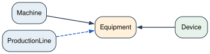
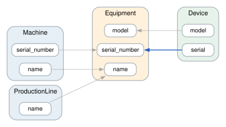
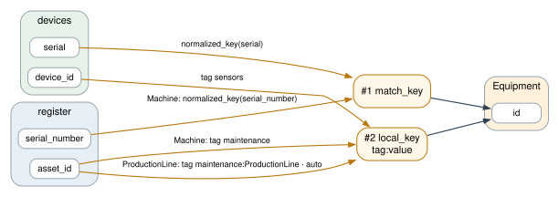
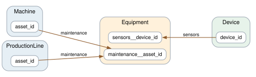

# maintenance + sensors

The merge goes through.

## Equipment: Machine + ProductionLine ~ Device

- Declared by `vertex_equivalences[0]`.
- Joined by a vocabulary: ProductionLine.
- Keyed by a funnel: a record tries 2 branches in order and the first it completes is digested into `id`. Each member's own key becomes a lookup.
- `Machine.asset_id` is kept as `maintenance__asset_id`, a lookup in key space `maintenance`.
- `ProductionLine.asset_id` is kept as `maintenance__asset_id`, a lookup in key space `maintenance`.
- `Device.device_id` is kept as `sensors__device_id`, a lookup in key space `sensors`.

*Members. The types that become the merged type; a dashed edge marks a member a vocabulary joins rather than one the equivalence names.*

*Attributes. Where each member attribute lands on the merged type: dark, a declared equivalence; blue, a vocabulary rename; thin grey, the name kept as it is; dotted, a mapping a later declaration overrode.*

*Identity. The raw fields each branch reads, labelled with the transform or the tag; a record tries the branches in order, #1 first, and the first it completes keys it.*

*Lookups. Each member's own key, kept on the merged type as a lookup in the key space the edge names.*

Findings:

1. **note** `auto_local_key`: left:ProductionLine joins 'Equipment' without a key source for resource 'register'; its records key on their own 'asset_id' as 'maintenance:ProductionLine:<value>' and never fuse with another member's
2. **note** `lookup_demotion`: records of left:Machine key on the first of ['match_key', 'local_key'] they complete, so two with the same ['maintenance__asset_id'] that complete different ones become two 'Equipment' vertices; ['maintenance__asset_id'] is now the lookup-only secondary 'maintenance' and no longer deduplicates them
3. **note** `lookup_demotion`: records of right:Device key on the first of ['match_key', 'local_key'] they complete, so two with the same ['sensors__device_id'] that complete different ones become two 'Equipment' vertices; ['sensors__device_id'] is now the lookup-only secondary 'sensors' and no longer deduplicates them
4. **note** `shared_key_space`: left:['Machine', 'ProductionLine'] share the key 'maintenance' on 'Equipment': an id of one finds a node of another
